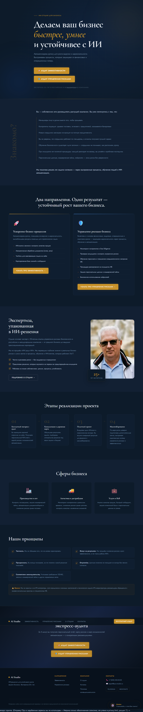
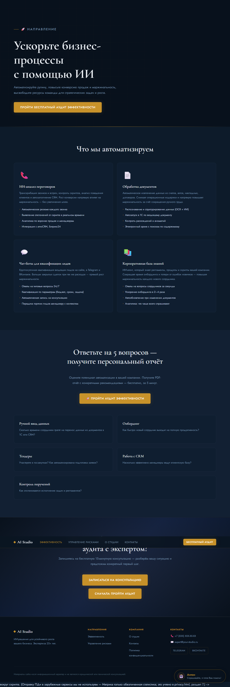
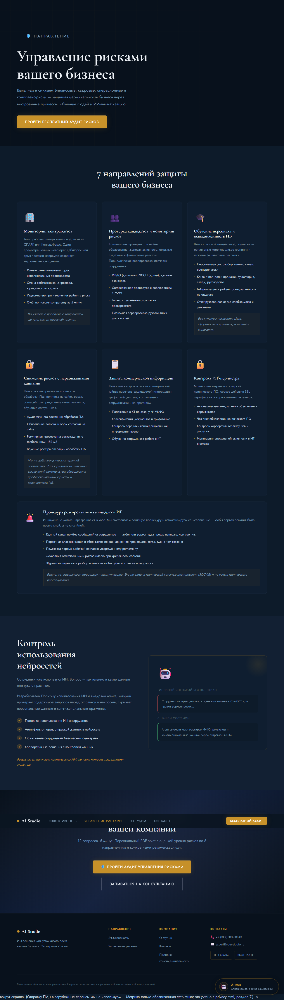
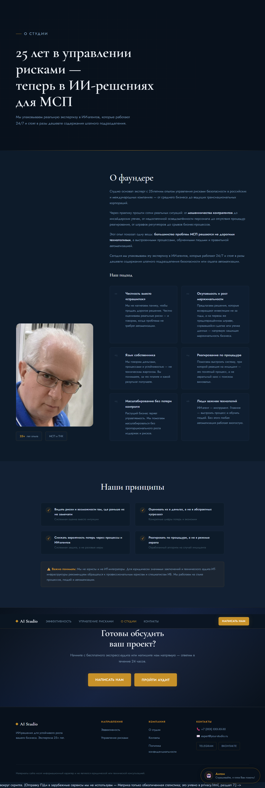
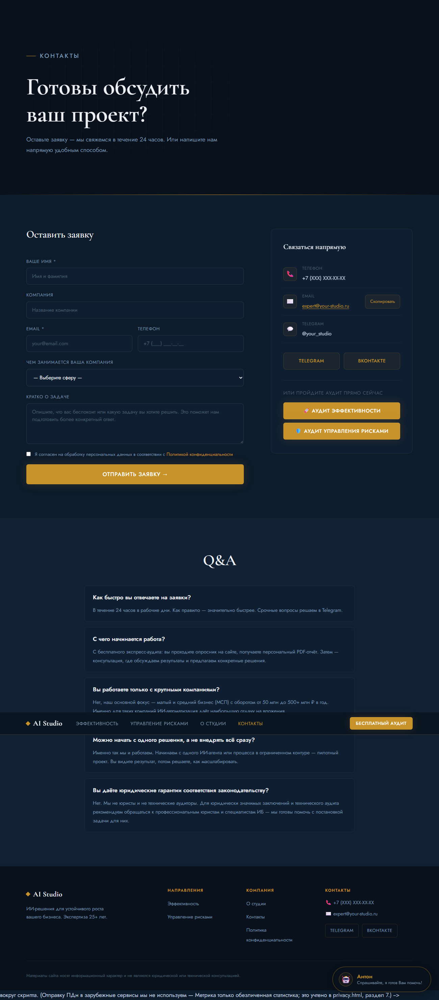

# AI Studio — лендинг

Сайт-лендинг AI Studio: ИИ-студия для малого и среднего бизнеса (МСП) — аудит эффективности, аудит управления рисками, внедрение ИИ-ассистентов.

## Состав

| Путь | Описание |
|---|---|
| `index.html`, `efficiency.html`, `security.html`, `about.html`, `contacts.html`, `privacy.html` | Страницы сайта (адаптив, тёмная тема: navy `#0D1B2A` + amber `#C8922A`, шрифты Cormorant Garamond + Jost) |
| `css/style.css` | Дизайн-система |
| `js/main.js` | Квиз, навигация, чат-бот, форма контактов; константа `API {base, token}` и `apiPost()` |
| `backend/` | FastAPI-оркестратор (Python 3.12): квиз, контакты, чат-бот с RAG, статистика, email-уведомления, дайджест по расписанию, rate-limit + honeypot |
| `База_знаний_SDaaS/`, `База_знаний_бота_бизнеспроцессов/`, `Chat_bot_knowledge_base/` | Базы знаний ботов (для RAG) |
| `*system_prompt*` | Системные промпты ботов |
| `robots.txt`, `sitemap.xml`, `Assets/favicon.png` | SEO-файлы |
| `docs/` | Скриншоты страниц для этого README |

## Backend

Стек: FastAPI + SQLite, docker-compose + Caddy на VPS. LLM — YandexGPT (Yandex AI Studio), эмбеддинг-модель Yandex `text-search-{doc,query}`, векторный индекс — собственный JSON (`backend/data/rag_index.json`, numpy-косинус).

Подробно о деплое — [backend/README.md](backend/README.md).

```bash
cd backend
cp sample.env .env      # вписать ключи (не коммитится)
pip install -r requirements.txt
uvicorn app.main:app --reload

# Пересборка RAG-индекса после правки баз знаний
python -m scripts.build_rag_index

# Проверка всех подсистем
python scripts/smoke_test.py
```

## Интеграции и механики

- Квизы «Аудит эффективности» (5 вопросов) и «Аудит управления рисками» (12 вопросов), A=2/Б=1/В=0 → отчёт PDF-формата в браузере.
- Чат-бот «Антон»: системный промпт + RAG-контекст (топ-4 фрагмента), протокол `<LEAD>` — бот сам собирает лид, кнопки-действия (квиз/переход к форме) прямо в ответах.
- Атрибуция: чат→квиз через `sessionStorage aistudio_chat_sid`, квиз→консультация через `report_id` в CTA.
- Метрики воронки из таблицы `events`: `/api/stats?days=N`; ежедневный дайджест менеджеру по расписанию (`DIGEST_HOUR`, МСК).
- Email-уведомления о горячих лидах через SMTP (Yandex 360 на своём домене). ПДн в зарубежные сервисы не уходят.
- Rate-limit (chat 30/10мин, квиз 10/час, форма 5/час) + honeypot-поле `website`.

## Секреты

`backend/.env` содержит ключи (Yandex API, токен сайта) и **не коммитится** — см. `.gitignore`. Шаблон: `backend/sample.env`.

## Скриншоты

Страницы сайта (тёмная тема, кликните для полного размера):

| Главная | Аудит эффективности |
|---|---|
| [](docs/main.png) | [](docs/efficiency.png) |

| Управление рисками | О студии | Контакты |
|---|---|---|
| [](docs/security.png) | [](docs/about.png) | [](docs/contacts.png) |

